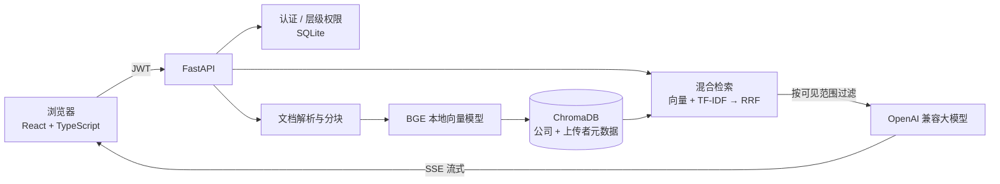

# 知渊 · 多租户分级权限企业知识库

基于 RAG 的企业知识库问答系统。多家公司共用一套平台、各自拥有独立的知识库：平台方只负责开通公司、看不到任何公司的数据；公司内部按职级控制文档可见范围，隔离一直做到问答检索这一层。

**在线演示**：http://150.158.119.206:3000
演示账号（高级用户）：`demo` / `demo123456`

> 问答需要在页面右上角「设置」里填写 OpenAI 兼容的 API Key（如 DeepSeek）；不填 Key 也可以体验上传、文档管理和用户管理。
>
> 


## 核心特性

### 1. 四级层级权限 + 多租户

| 角色 | 文档 | 用户管理 |
|---|---|---|
| 平台老板 | **看不到任何公司的文档** | 生成一次性注册密钥；只能看到公司名称和人数 |
| 公司老板 | 上传；查看、删除全公司文档 | 创建高级/低级用户，升级、降级、删除 |
| 高级用户 | 上传；查看自己和本公司低级用户的文档 | 创建低级用户 |
| 低级用户 | 上传；只看自己的文档 | 无 |

- 下级账号只能由上级创建；公司老板凭平台发放的一次性、带有效期的密钥自助注册公司。
- **开通权与数据权分离**：对应 SaaS 中"服务商不能查看客户数据"的要求。
- 所有管理操作都要求"同一公司且级别严格更高"，越权统一返回 404，不暴露目标是否存在。

### 2. 隔离做到检索层，避免"问答串数据"

多用户 RAG 常见的漏洞是只在文档列表做了过滤，向量检索却搜全库，导致 A 公司提问时把 B 公司的片段拼进答案。本项目在三处隔离：

- **向量库**：每个文本块写入时标记公司和上传者，检索时用元数据过滤，返回后再在内存中二次校验。
- **关键词索引**：不按公司分别缓存，查询时实时按可见范围过滤，避免缓存串数据。
- **文件存储**：每家公司单独目录。

可见范围在**查询时实时计算**，所以职级调整后立即生效，无需重建任何数据。

### 3. 混合检索（RRF）

向量检索（本地 BGE 中文模型）与 TF-IDF（jieba 分词）两路并行召回，用 **RRF（倒数排名融合）** 合并：

```
score(d) = Σ 1 / (60 + rank_i(d))
```

两路分数量纲不同，不能直接加权，RRF 只看排名；相比"按关键词重合度二选一"，不会只走一路而漏掉另一路的结果。

在自建企业制度语料（42 条文档 / 44 个问题）上的对比，详见 [`backend/benchmark`](backend/benchmark/README.md)：

| 方案 | Hit@1 | Hit@4 | MRR |
|---|---|---|---|
| 按重合度二选一 | 88.6% | 100.0% | 0.936 |
| RRF 融合 | **93.2%** | 97.7% | **0.955** |

RRF 让正确答案整体排得更靠前，但有 1 条问题从命中变为未命中（多路同时命中的文档会压过单路第一名），评估文档里记录了原因和改进方向。语料为人工构造，不代表线上真实流量。

### 4. 其他

- 本地向量模型，文档向量化不调用外部 API；FAQ 高相似度问题直接命中，不调用大模型。
- 兼容 OpenAI 协议的大模型，用户可在前端自带 Key 和中转地址，服务器不保存任何 Key。
- SSE 流式输出，回答附带引用原文与相似度。

## 架构



## 技术栈

- **前端**：React 19、TypeScript、Vite
- **后端**：FastAPI、LangChain、ChromaDB、scikit-learn、jieba、Transformers（BAAI/bge-small-zh-v1.5）
- **认证**：JWT（python-jose）、bcrypt

## 目录结构

```
backend/
  app/
    api/          routes.py（文档与问答）、hierarchical_routes.py（层级用户管理）、auth_routes.py（登录）
    services/     hierarchical_rbac.py（权限模型）、vectorstore_service.py（混合检索）、rag_service.py ...
    auth/         JWT 与用户库
  tests/          端到端权限测试、RRF 检索测试
  benchmark/      检索评测语料、问题集与评测脚本
frontend/
  src/components/ ThreeColumnLayout、UserManagement、ChatInterface、LoginPage、RegisterPage ...
```

## 本地运行

**后端**（Python 3.9+）

```bash
cd backend
python -m venv venv && venv\Scripts\activate      # macOS/Linux: source venv/bin/activate
pip install -r requirements.txt
cp .env.example .env                              # 设置 JWT_SECRET_KEY、ADMIN_INITIAL_PASSWORD
python -m uvicorn app.main:app --reload --port 8000
```

首次启动会自动创建平台管理员 `admin` 并设为平台老板，初始密码取 `ADMIN_INITIAL_PASSWORD`（未设置则随机生成并打印在日志中）。首次运行需联网下载 BGE 模型。

**前端**（Node 18+）

```bash
cd frontend
npm install
npm run dev        # http://localhost:5173，后端地址通过 VITE_API_BASE_URL 配置
```

**测试与评测**

```bash
cd backend
python tests/test_rrf_retrieval.py                                   # 离线检索对比（不依赖服务）
python benchmark/run_benchmark.py                                    # 44 题检索效果评测，输出 Hit@K / MRR
BASE_URL=http://127.0.0.1:8000 ADMIN_PASSWORD=<密码> python tests/test_permissions_e2e.py   # 42 项权限与隔离测试
```

端到端测试会创建测试公司和用户，请勿对生产环境运行。

## 使用流程

1. 平台老板登录 →「用户管理」→ 生成注册密钥，发给公司老板。
2. 公司老板在登录页点「立即注册」，填写密钥和公司名称完成注册。
3. 公司老板在「用户管理」中创建高级/低级用户；各级用户在「文档管理」上传文档、在中间区域提问。

## 后续计划

- 检索：RRF 之后接 reranker（如 bge-reranker）精排
- 审计日志：记录谁在何时查询了哪些文档
- 部署：HTTPS、多进程、文档向量化放入任务队列
